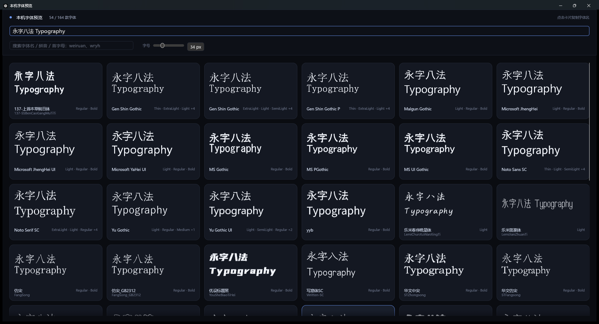

# 本机字体预览

原生 Windows 桌面程序（Rust + egui + DirectWrite / GDI）。不启动浏览器、不起后台服务，
双击一个 exe 就能把系统里的字体按你输入的文字实时铺成卡片。

输入文字后逐字检查字形覆盖，只留下能完整渲染这段文字的字体；支持字体名模糊搜索与拼音搜索。



## 下载

直接下载根目录的 `字体预览.exe` 双击运行（Windows 10/11，单文件，无需运行时）。
也可以从 [Releases](https://github.com/ziyitty/font-preview/releases/latest) 下载 `font-preview.exe`（内容一致）。

## 功能

- **按文字筛字体**：输入中文 / 英文 / emoji，缺字形就用不了的字体直接不出现
- **实时预览**：每张卡片用该字体自身渲染你的文字，两行自动换行
- **拼音搜索**：`weiruan` → 微软雅黑，`wryh` → 微软雅黑（首字母），`fangsong` → 仿宋
- **模糊搜索**：`msyh` → Microsoft YaHei（子序列匹配），按前缀 > 子串 > 子序列排序
- **字号调节**：20–72 px，卡片高度同步变化
- **右键菜单**：打开文件位置（资源管理器定位到 ttf / ttc 并选中）、复制字体族名
- **左键点击**：复制字体族名；`Ctrl+F` 聚焦搜索框

## 自己编译

需要 Rust 1.85+ 与 MSVC 工具链。

```bash
cargo build --release
copy target\release\font_preview.exe 字体预览.exe
```

跑测试：

```bash
cargo test --release
```

## 结构

```
src/main.rs    // eframe 窗口、顶部栏、卡片网格（虚拟滚动）、纹理缓存、右键菜单
src/fonts.rs   // DirectWrite 枚举字族 + HasCharacter 逐字覆盖 + 拼音 / 模糊打分 + 字体文件路径
src/gdi.rs     // GDI 把文字画进位图，量行高、垂直居中，转成 egui 纹理
```

## 实现要点

- **枚举**：`IDWriteFactory::GetSystemFontCollection`，按 family 归并，取 en-us 名给 GDI、zh-cn 名做展示
- **覆盖检测**：`IDWriteFont::HasCharacter(codepoint)` 逐字判断，空白 / 控制符 / 变体选择符 / ZWJ 不参与；
  结果按 `(字体序号, 字符)` 缓存，重复输入直接命中
- **搜索**：每个字族预生成归一化匹配串（英文名、中文名、全拼、首字母），`pinyin` crate 负责转拼音
- **文件定位**：`IDWriteFontFile::GetReferenceKey` + `IDWriteLocalFontFileLoader::GetFilePathFromKey`，
  再用 `SHOpenFolderAndSelectItems` 在资源管理器里定位
- **渲染**：不把字体文件读进内存，GDI 直接用系统字体画到 DIB，扫描墨迹范围做垂直居中后上传成纹理；
  只栅格化可见卡片，纹理按 (字体, 文字, 尺寸) 缓存并做 LRU 淘汰
- **UI 字体**：读 `msyh.ttc` 注册进 egui，保证中文标签正常

## 平台

Windows（DirectWrite + GDI + Shell）。换 macOS / Linux 需要替换 `fonts.rs` 的枚举与 `gdi.rs` 的栅格化。
